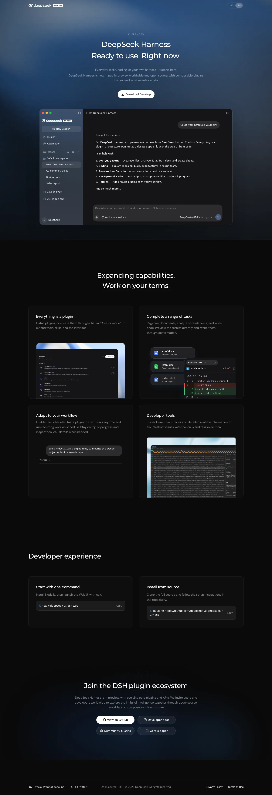
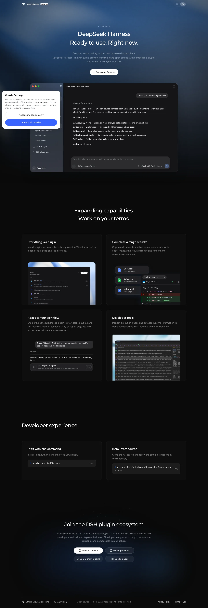

# DeepSeek Harness landing — Next.js clone

A section-by-section port of <https://www.deepseek.com/en/harness/> built with
Next.js 16 (App Router), React 19 and Tailwind CSS 4. The original markup and its
compiled design-system stylesheets are reused as-is, so spacing, typography and
colours match the live page (same document height: 4199 px at 1440 px wide).

**Clone** (1440 px, full page):



**Live site**, captured with the same viewport for comparison:



## Run it

```bash
npm install --include=dev
npm run dev                 # http://localhost:3000
```

`--include=dev` matters only if `NODE_ENV=production` is exported in your shell;
otherwise plain `npm install` is enough.

Production build:

```bash
npm run build
npm start -- -p 3100
```

## How it is put together

| Path | Role |
| --- | --- |
| `app/page.jsx` | Composes the sections in the site's order, sets `data-theme="dark"` |
| `app/layout.jsx` | Metadata, favicons, and the pre-paint script that arms the scroll reveal |
| `app/globals.css` | Tailwind import, reveal glue, hero backdrop approximation |
| `app/styles/*.css` | The four stylesheets served by the live page, unchanged (tokens `--ds-*`, layout utilities, animations, `@font-face`) |
| `components/*.jsx` | Page markup converted 1:1 to JSX, split along the site's own section boundaries |
| `components/Reveal.jsx` | Ports the site's scroll-in reveal; generator strips the server-side hidden states so the page also works without JS |
| `public/` | Fonts, screenshots, file-type icons and favicons |
| `scripts/build-from-html.mjs` | HTML → JSX converter (used to generate `components/`) |
| `scripts/patch-hero.mjs` | Replaces the canvas hero backdrop after a regeneration |

Regenerate from a fresh copy of the page:

```bash
node scripts/build-from-html.mjs /path/to/page.html
node scripts/patch-hero.mjs
npm run build
```

## Known differences with the live site

| Area | Status |
| --- | --- |
| Cookie banner | Not cloned on purpose |
| Hero backdrop | Live page paints a WebGL canvas; approximated with a CSS radial gradient sampled from it |
| Scroll-morphing header pill | Not implemented (appears on scroll on the live site) |
| "Adapt to your workflow" card media | Rendered by client JS upstream; the static clone shows the empty frame |
| Footer "X (Twitter)" link | Client-rendered upstream; absent here |
| Preview conversation | Present, static; the live page types it out |

## Stack

- Next.js 16.4.2 · React 19.3.1 · Tailwind CSS 4.3.3
- Fonts: DM Sans, Montserrat, Host Grotesk, Fragment Mono (self-hosted)
- No client-side dependency besides React; the reveal is a 40-line
  `IntersectionObserver` component

## Notice

This repository is a technical study of how the DeepSeek Harness landing page is
built. "DeepSeek", "DeepSeek Harness", the logo, the copy, the screenshots and
the typefaces belong to DeepSeek; this project is not affiliated with them and
grants no licence over that material. Replace the content in `public/` and
`components/` before using the layout for your own product.
